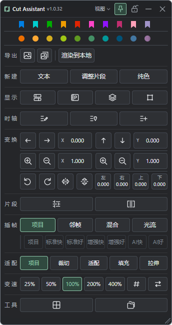

# Cut Assistant 下载

Cut Assistant 是面向 Windows 和 DaVinci Resolve Studio 的剪辑辅助插件，将常用的时间线、片段、变换、变速、显示与颜色操作集中在一个可调整的面板中。

**当前版本：1.0.32。**需要 DaVinci Resolve Studio 21.1 或更新版本，不能脱离达芬奇独立运行。

上图由当前版前端源码和模拟状态生成，用于展示面板布局，不代表在真实达芬奇工程中的功能测试。

## 下载与安装

从[最新版本下载页](https://github.com/Pawaganti/Cut-Assistant-Downloads/releases/latest)选择一种方式：

| 安装方式 | 下载文件 | 操作 |
| --- | --- | --- |
| 普通安装 | `Cut-Assistant-1.0.32-Installer.zip` | 解压，双击 `安装.cmd`。 |
| 直接复制 | `Cut-Assistant-1.0.32-Portable.zip` | 解压，将整个 `Fusion` 文件夹复制到达芬奇的 `Support` 目录。 |

两种方式选一种即可。安装路径、首次快捷键配置和使用注意事项见[详细安装说明](docs/安装说明.md)。安装后在达芬奇的 **工作区 → 脚本 → Cut Assistant** 打开。

下载页同时提供 `SHA256SUMS.txt`，用于核对文件完整性。运行包内含插件所需代码及资源；本公开仓库只保存使用说明和版本下载，不包含独立的源码归档、个人设置或工程素材。

## 本版说明

助手打开时读取一次当前状态，之后不在后台持续轮询；需要核对时可手动刷新。包内 PDF 手册仍有旧版自动刷新表述，以本版安装说明为准。本次发布已核验安装包内容、校验值与离线界面检查，尚未在真实达芬奇工程中重新完成全功能验收。
